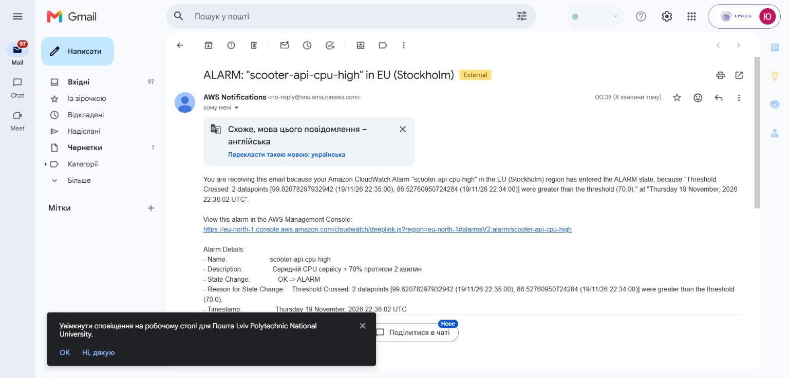
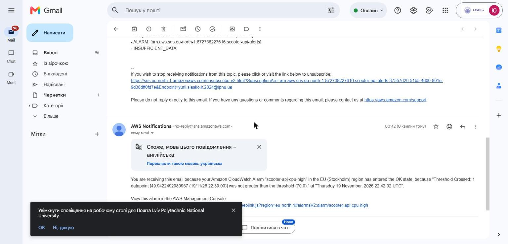

# Алерти

Описані в `terraform/monitoring.tf`: SNS topic `scooter-api-alerts` + підписка e-mail + CloudWatch alarm `scooter-api-cpu-high`.

## Умова

Середній CPU сервісу > 70 % протягом 2 послідовних хвилин (period 60 с, evaluation_periods 2).

Обґрунтування:
- 70 % вище цілі скейлінгу (60 %): спрацьовує, коли автоскейлінг не впорався або вже на максимумі, тобто потрібна увага людини, а не звичайна робота системи.
- Вікно 2 хвилини відсікає короткі піки (один важкий запит, деплой), щоб не було хибних тривог.
- `ok_actions` надсилає лист про відновлення, коли CPU повернувся нижче 70 %.
- `treat_missing_data = notBreaching`: відсутність даних не вважається аварією.

CPU обрано замість p95-латентності, бо він ловить насичення ресурсу до того, як його відчують користувачі. Недолік CPU: не бачить проблем, що не вантажать CPU (повільна БД, блокування); латентність краще відображає досвід користувача, але шумніша.

## Підтвердження підписки

Після `terraform apply` AWS надсилає на пошту лист "AWS Notification - Subscription Confirmation". Без натискання на посилання листи алертів не приходитимуть.

## Результати (прогін без кешу, 19.11.2026)

Лист про перевантаження (ALARM, 22:38:02 UTC = 00:38 за Києвом):

Лист про відновлення (OK, 22:42:02 UTC = 00:42 за Києвом):

| Подія | Час (UTC) |
|---|---|
| Старт k6 | 22:33:19 |
| Початок steady-фази (кінець ramp-up) | 22:36:19 |
| CPU > 70 % (хвилинні точки 22:34 = 86 %, 22:35 = 100 %) | 22:34-22:35 |
| Алярм -> ALARM, лист надіслано | 22:38:02 |
| Другий інстанс прийняв трафік, CPU впав до 50 % | 22:39:50 |
| Алярм -> OK, лист надіслано | 22:42:02 |

**Від початку steady-навантаження до першого листа: 1 хв 43 с** (від старту тесту - 4 хв 43 с; від реального перевищення 70 % - ~3 хв).

Звідки ці ~3 хв: 2 хвилини вікна (2 точки по 60 с), ~1 хв затримка публікації метрики ECS, плюс період оцінки алярму. Лист SNS прийшов за кілька секунд.

Оцінка: для навчального сервісу 3 хвилини прийнятно - автоскейлінг усе одно реагує ще повільніше (~5 хв), тож алерт приходить раніше, ніж система сама впорається, і людина встигає подивитись. Для продакшну з SLA це задовго: 3 хв при 100 % CPU користувачі вже бачать p95 ~1 с. Покращення: high-resolution метрики (10-30 с), алерт на p95 латентності, яку відчуває користувач, або M-з-N (наприклад 2 з 3) замість суворої послідовності.

Повторне OK -> ALARM не повторювалось у прогоні: після додавання інстансу CPU тримався на 68-74 %, але тільки одна точка (22:41) була > 70 %, тож вікно 2 хв відсікло коливання (захист від flapping).
