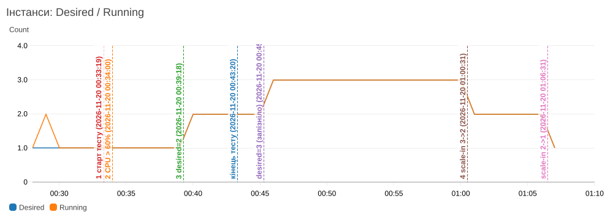
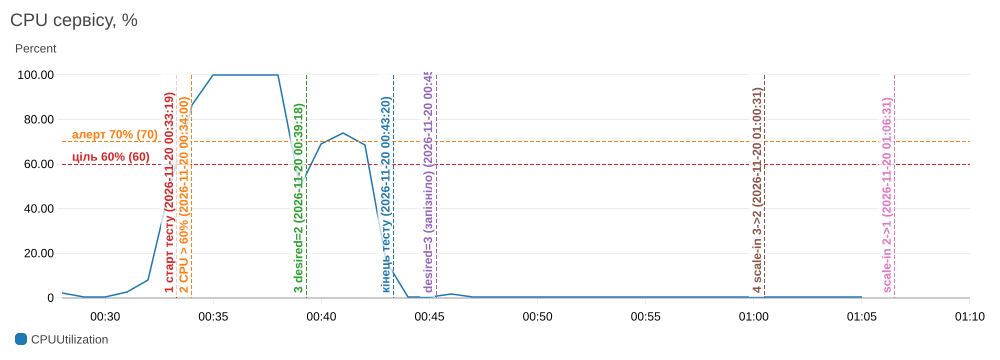
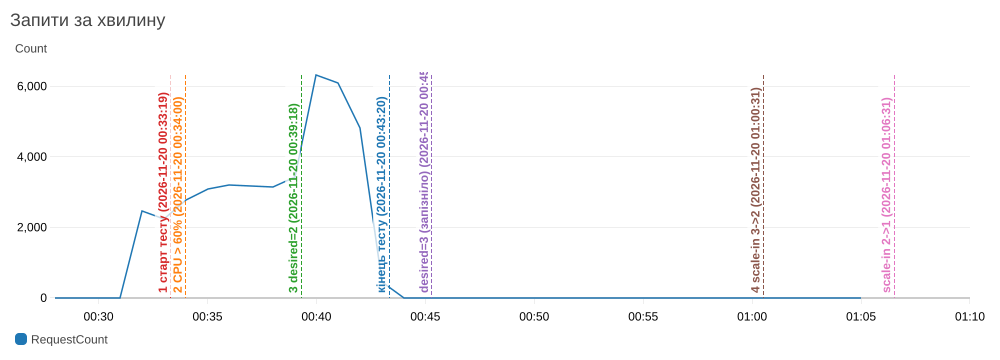
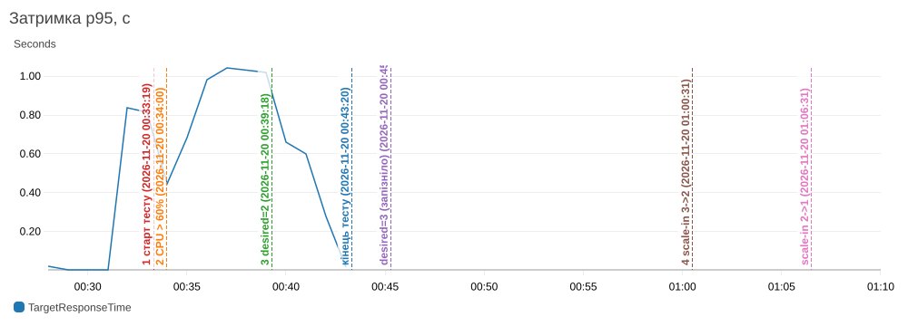
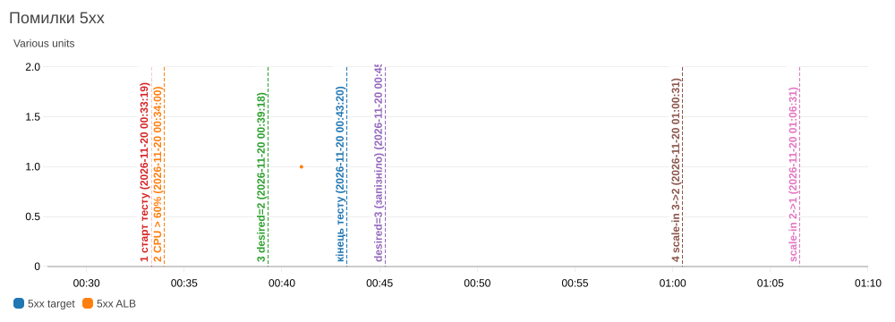
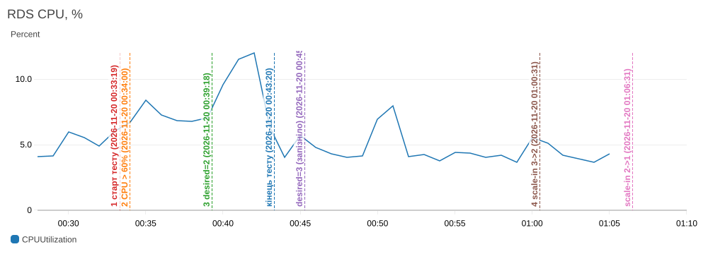

# Автоскейлінг

## Параметри (terraform/autoscaling.tf)

| Параметр | Значення | Чому |
|---|---|---|
| min / max інстансів | 1 / 3 | Мінімум економить гроші в простої. Максимум 3 (ліміт лаби 4) обмежує витрати і навантаження на БД: пул 10 з'єднань на інстанс = до 30 з'єднань при ~80 доступних у db.t3.micro |
| Метрика | `ECSServiceAverageCPUUtilization` | Наш застосунок CPU-bound: серіалізація JSON і робота з БД на 0.25 vCPU. CPU корелює з навантаженням і не вимагає додаткової інструментації |
| Ціль | 60 % | Запас 40 % на сплески, поки новий інстанс стартує (~1-2 хв). При цілі 80-90 % інстанс захлинеться раніше, ніж з'явиться допомога |
| scale_out_cooldown | 60 с | Швидко додаємо потужність: недобір дорожчий за надлишок |
| scale_in_cooldown | 300 с | Повільно прибираємо: щоб не "смикати" кількість інстансів між піками (flapping) |

## Що таке cooldown і що буде при 0

Cooldown - пауза після дії скейлінгу, протягом якої нова дія того ж напрямку не виконується. Вона дає час, щоб зміна проявилась у метриці (новий інстанс прогрівся і почав приймати трафік).

При cooldown = 0 політика реагує на кожне вимірювання. Метрика ще не відображає щойно доданий інстанс, тому політика додає ще один, потім ще (перескейл до max). Потім CPU падає, і вона так само швидко прибирає інстанси: система хитається вгору-вниз (flapping), кожен запуск/зупинка коштує грошей і втрачає запити.

## Дашборд

CloudWatch dashboard `scooter-api` описаний у `terraform/monitoring.tf`: (1) Desired/Running інстанси, (2) CPU, (3) запити за хвилину, (4) p95 затримка, (5) 5xx. Додатково - CPU і з'єднання RDS.

## Скріншоти і спостереження (прогін без кешу, N = 40, 19.11.2026)

Графіки згенеровані з метрик дашборда `scooter-api` через CloudWatch `GetMetricWidgetImage`. Час на графіках київський (UTC+2), у тексті нижче - UTC. Вертикальні позначки: (1) старт навантаження, (2) CPU перетнув 60 %, (3) додано інстанс, (4) прибрано інстанс.

Хронологія (з історії ECS, Application Auto Scaling і CloudWatch alarms):

| Час (UTC) | Подія |
|---|---|
| 22:33:19 | старт k6 (ramp-up 3 хв) |
| 22:34 | хвилинна точка CPU = 86 % - поріг 60 % перетнуто |
| 22:35-22:38 | CPU ~100 %, p95 ~1 с |
| 22:38:02 | алерт `scooter-api-cpu-high` -> ALARM, лист на пошту |
| 22:39:18 | target tracking: desired 1 -> 2 |
| 22:39:50 | новий інстанс зареєстровано в ALB, 22:40:00 - steady state |
| 22:43:20 | кінець тесту |
| 22:45:18 | desired 2 -> 3 (запізніла реакція на CPU 69-74 % о 22:40-22:42) |
| 23:00:31 | scale-in 3 -> 2 |
| 23:06:31 | scale-in 2 -> 1, о 23:06:55 працює 1 інстанс - повернулись до мінімуму |

Виміряні затримки:
- старт тесту -> перетин 60 %: ~1 хв;
- перетин 60 % -> зростання Desired: ~5 хв (22:34 -> 22:39:18);
- Desired -> новий інстанс приймає трафік: ~30 с (Fargate старт + 2 успішні health check);
- кінець навантаження -> перший scale-in: ~17 хв, до мінімуму: ~23 хв.

### Чому scale-out запізнюється

1. Метрика `CPUUtilization` сервісу ECS агрегується за 1 хв і публікується із затримкою ~1 хв.
2. Алярм `AlarmHigh`, який створює target tracking, вимагає 3 послідовні хвилинні точки вище цілі.
3. Перша точка (22:33) вийшла 50 % - нижче цілі, тож відлік почався з 22:34; ще одна точка між проходами алярму "загубилась" через затримку публікації, тому ALARM - о 22:39:18.
4. Далі Fargate завантажує образ і запускає контейнер, ALB чекає 2 успішні health check.

Наслідок видно на графіку: найгірші 5 хв (CPU 100 %, p95 ~1 с) система відпрацювала одним інстансом. Третій інстанс з'явився вже після кінця тесту - бо політика реагує на минуле, а не на поточне навантаження. Саме тому ціль 60 %, а не 90 %: запас покриває ці хвилини реакції.

### Чому scale-in повільний

Алярм `AlarmLow` вимагає 15 хвилинних точок нижче ~54 % (90 % від цілі), а після кожного зменшення діє `scale_in_cooldown = 300 с`. Це захист від flapping: короткий спад між хвилями навантаження не прибирає інстанси, які за хвилину знову знадобляться. Ціна - 20+ хвилин зайвих інстансів після піку.

## Graceful shutdown

При scale-in ALB перестає слати нові запити на інстанс (`deregistration_delay = 30` с), ECS шле SIGTERM, uvicorn дообслуговує активні запити і завершується. Це працює, бо застосунок stateless: стан живе в Postgres і Redis, а не в пам'яті інстансу.
