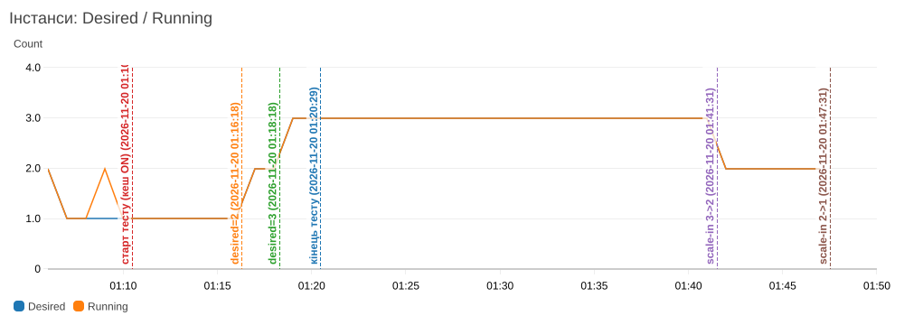
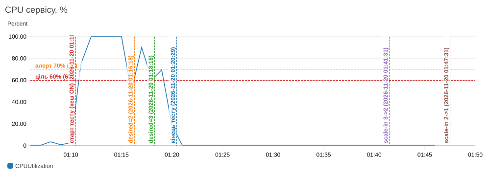
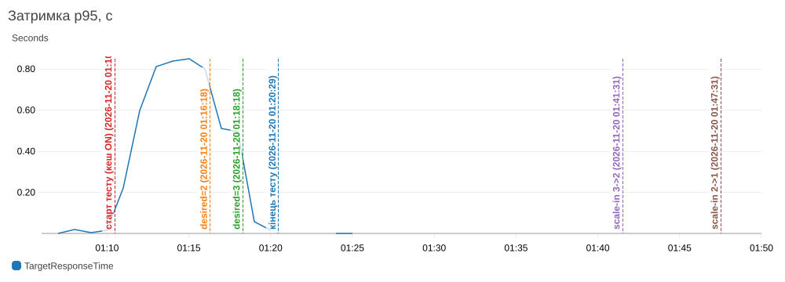
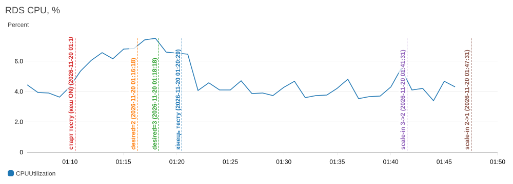

# Кешування читань

## Реалізація

Найважчий читальний запит - `GET /scooters/report` (GROUP BY по всій таблиці). Застосунок (`main.py`) використовує cache-aside:

1. Перевірити Redis (`cache:scooters:report`). Якщо є - повернути (заголовок `X-Cache: HIT`).
2. Якщо немає - виконати запит у БД, записати результат у Redis з TTL 45 с, повернути (`X-Cache: MISS`).

Сховище: AWS ElastiCache Redis (`terraform/cache.tf`), спільний для всіх інстансів. In-process кеш був би окремим у кожному інстансі: після масштабування hit rate падає, а дані між інстансами розходяться. Якщо Redis недоступний, застосунок переходить на БД і не падає. Перемикач: `cache_enabled` (змінна Terraform -> `CACHE_ENABLED`).

Лічильники hit/miss зберігаються в Redis, `GET /cache/stats` показує сумарний hit rate, `POST /cache/stats/reset` скидає їх перед тестом.

## Порівняння

Два прогони `loadtest/scenario.js` з однаковим N = 40 (19.11.2026). Перемикання: `terraform apply -var cache_enabled=false` / `=true`. Показники БД - середнє за 5 хв steady-фази з CloudWatch.

| Показник | Без кешу | З кешем | Зміна |
|---|---|---|---|
| p95 затримки (усі запити) | 986 мс | 806 мс | -18 % |
| p99 | 1 298 мс | 998 мс | -23 % |
| Запитів/с | 62.3 | 73.6 | +18 % |
| Запитів `/scooters/report` до БД | ~22 500 (кожен) | 74 | -99.7 % |
| RDS CPU, середній / макс | 7.5 % / 9.6 % | 6.8 % / 7.4 % | |
| RDS з'єднань, макс | 15 | 12 | |
| CPU сервісу API, середній | 84 % | 88 % | |

**Hit rate: 99.72 %** (26 440 hit / 74 miss, з `GET /cache/stats`, лічильники спільні для всіх інстансів у Redis).

74 miss = ~10 хв / 45 с TTL ≈ 13 перерахунків + одночасні miss від кількох інстансів у момент закінчення TTL (cache stampede в малому масштабі).

### Аналіз

Кеш майже повністю прибрав запити звіту з БД, але виграш у латентності помірний (-18 %), бо вузьке місце не БД, а CPU контейнера API (0.25 vCPU): RDS CPU і без кешу був лише ~7.5 %, таблиця невелика (десятки тисяч рядків). Із кешем API все одно серіалізує запити, розбирає HTTP, ходить у Redis і обробляє `GET /scooters/` (3 з 9 читань без кешу) та POST - тому CPU лишився високим, а звільнений час пішов на обслуговування більшої кількості запитів (+18 % RPS).

Виграш для БД стане вирішальним, коли таблиця виросте: `GROUP BY` по всій таблиці росте лінійно з кількістю рядків, а з кешем коштує 1 запит на 45 с незалежно від навантаження і від кількості інстансів.

### Графіки прогону з кешем

Скейлінг з кешем: desired 1 -> 2 о 23:16:18, 2 -> 3 о 23:18:18, назад до 1 о 23:47:31 (CPU API лишався вузьким місцем, тому кількість інстансів така сама, як без кешу).

## Застарілість

Запис живе до TTL, тому дані можуть відставати до 45 с (максимальна застарілість = TTL): новий самокат із POST з'явиться у звіті не одразу. Для звіту по брендах це прийнятно.

Як зменшити застарілість:
- коротший TTL (платимо меншим hit rate);
- інвалідація при записі (`DELETE` ключа після POST) - але при частих записах (як у тесті: 1 запис на 9 читань) кеш майже не працюватиме;
- write-through: оновлювати кеш під час запису.

Cache stampede: коли ключ спливає, багато одночасних запитів йдуть у БД. Рішення: lock/single-flight на перерахунок, випадковий jitter у TTL, фонове оновлення до закінчення TTL.
